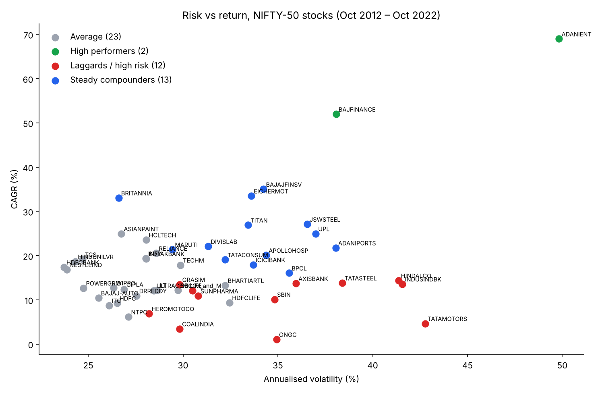
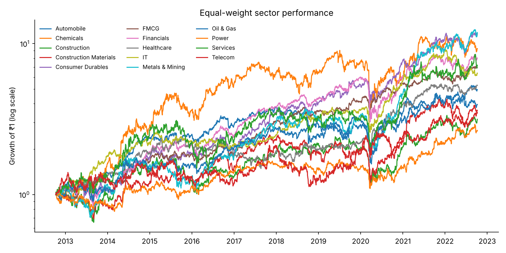
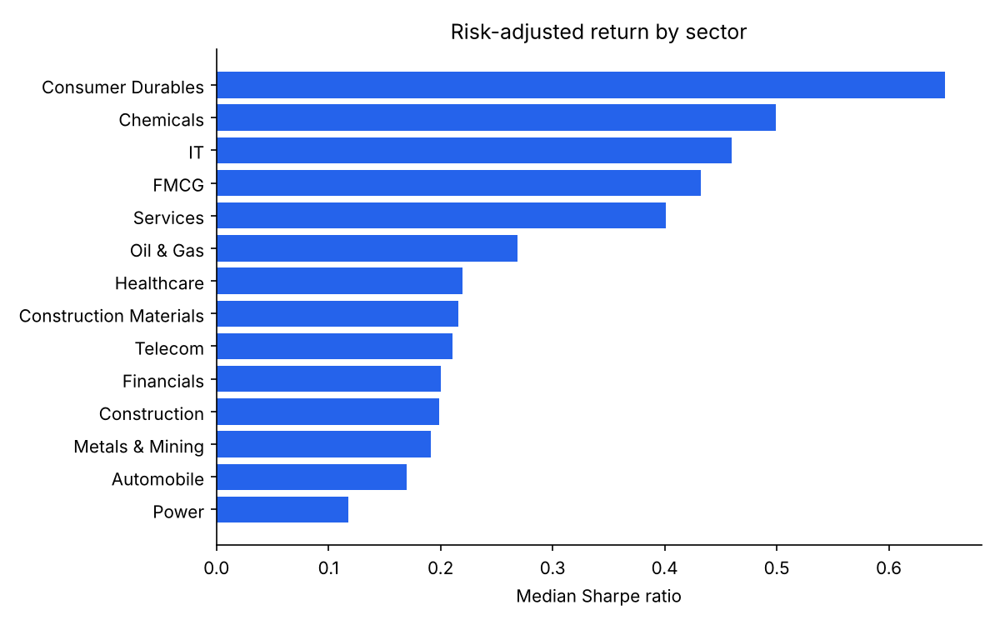
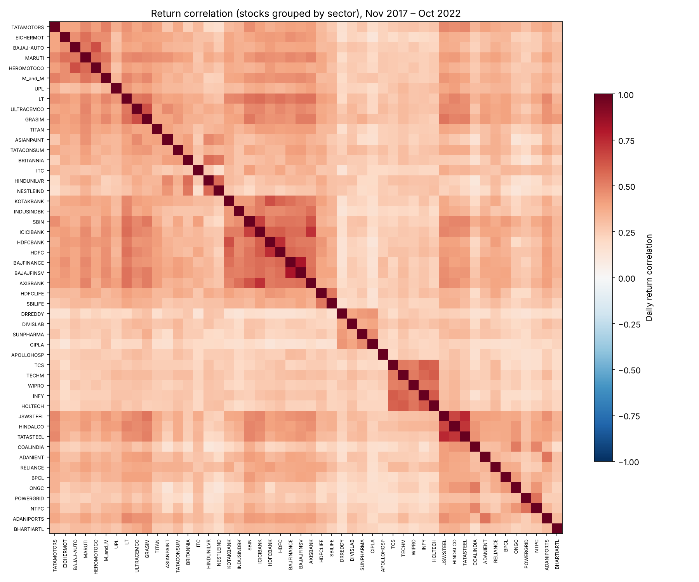
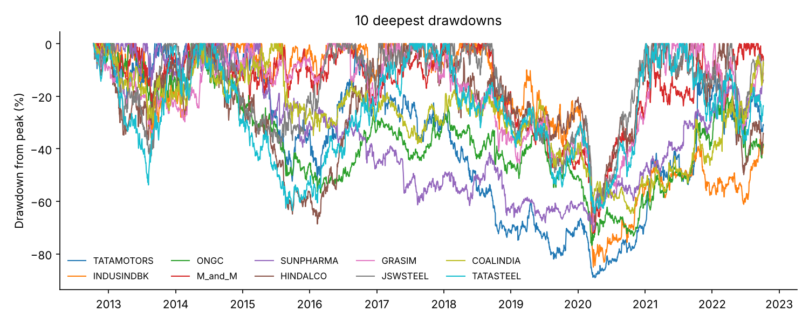

# Data-Driven Investment Intelligence Using NIFTY-50 Market Data

**Student Cultural Council, IIT Roorkee** · June – August 2026

A risk-and-return study of all 50 NIFTY-50 stocks over ten years of daily prices. It covers returns, volatility and drawdowns per stock and per sector; groups the stocks into performance segments; and finds pairs from different sectors whose returns barely move together, which is what you want for diversification.

## Data

- **Source:** daily OHLC, adjusted close and volume for every NIFTY-50 constituent, from [Ram9219/NIFTY-50-Stock-Market-Data-2000---2022-](https://github.com/Ram9219/NIFTY-50-Stock-Market-Data-2000---2022-) (originally Yahoo Finance). `run.py` downloads it on first run.
- **Coverage:** **10 Oct 2012 – 7 Oct 2022**, 2,463 trading days. 48 of the 50 stocks have the full 10 years; SBI Life and HDFC Life start at their 2017 listings.
- **Cleaning:** three level shifts in the source are bookkeeping errors, not real moves. History before each is rescaled so the series is continuous:

| Stock | Date | Problem |
|---|---|---|
| TATASTEEL | 16 Jun 2022 | split not adjusted: price doubles overnight |
| HDFC | 28 Dec 2015 | stale prices for several days, then a 50% jump |
| ADANIENT | 3 Jun 2015 | demerger not adjusted: −39% on the record date |

IndusInd Bank's +45% on 26 Mar 2020 really happened, so it stays.

## Method

| Step | How |
|---|---|
| Returns and risk | CAGR, annualised volatility, max drawdown, and Sharpe and Sortino ratios (6.5% risk-free rate), computed on adjusted close |
| Segmentation | K-means (k=4) on standardised CAGR, volatility, max drawdown and Sharpe. Clusters are named by their mean Sharpe |
| Consistency | Share of the 9 full calendar years (2013–2021) in which a stock beat the equal-weight average of all 50 |
| High performers | Beat the average in **more than half** of those years **and** above-median Sharpe. Both thresholds were fixed before looking at the count |
| Correlation | Daily return correlation over the common window (Nov 2017 – Oct 2022, 1,207 days, all 50 stocks trading) |
| Low-correlated pairs | Different sectors, correlation < 0.15 **and** never above 0.30 in any single calendar year, so the low correlation holds year after year |

## Results

| Finding | Result |
|---|---|
| Market data analysed | **10 years**, 50 stocks, 123K stock-days |
| Segments | High performers 2 · Steady compounders 13 · Average 23 · Laggards/high risk 12 |
| Consistently high-performing stocks | **14**: ADANIENT, BAJFINANCE, BRITANNIA, BAJAJFINSV, ASIANPAINT, TITAN, HCLTECH, JSWSTEEL, MARUTI, UPL, RELIANCE, INFY, HDFCBANK, APOLLOHOSP |
| Low-correlated cross-sector pairs | **13** stable pairs out of 1,109 cross-sector pairs (median pairwise correlation 0.31). The lowest is CIPLA–EICHERMOT at 0.12 |
| Best sectors by median Sharpe | see `outputs/sector_summary.csv` and the chart below |







## Dashboard

- **Interactive HTML:** `outputs/dashboard.html` has the risk/return scatter, sector growth, sector table, correlation heatmap, high performers and the pair list. Open it in any browser.
- **Power BI:** `powerbi/` has star-schema CSVs (fact table plus stock dimension) and `POWERBI_GUIDE.md`, which covers the model, the DAX measures and the page layout for building the `.pbix`.

## Run

```bash
pip install -r requirements.txt
python run.py
```

## Layout

```
run.py                 runs everything, writes outputs/ and powerbi/
src/data.py            download, load, sector map, corporate-action fixes
src/analysis.py        metrics, segmentation, consistency, correlation, selection rules
src/visuals.py         PNG charts and the HTML dashboard
outputs/               CSV tables, summary.json, plots/, dashboard.html
powerbi/               fact/dim CSVs and the Power BI build guide
```

Daily data ends in Oct 2022. To extend it, drop newer CSVs with the same columns into `data/raw/`.
